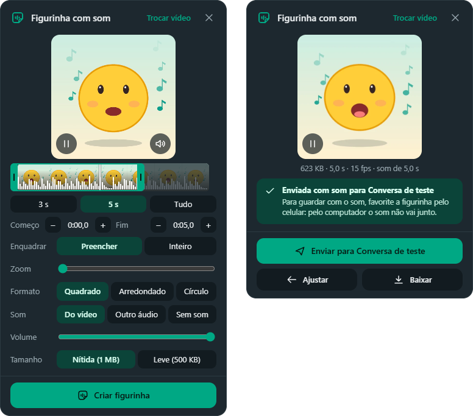
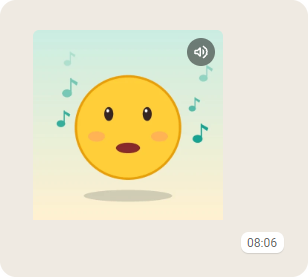

# Figurinha com Som

Extensão para o navegador que cria figurinhas com som no WhatsApp Web a partir de um vídeo, ou de
uma foto ou GIF com um áudio à parte. A figurinha sai no formato novo do próprio WhatsApp: imagem e
som na mesma mensagem, não uma figurinha seguida de um áudio.

A conversão acontece inteira no seu computador. Nada sai dele até você clicar em **Enviar**, e aí
vai só para a conversa que está aberta.

<p align="center">
  
</p>

## Instalar

Funciona no Chrome, Edge, Brave e Opera, na versão 111 ou mais nova. O aplicativo do WhatsApp para
Windows não aceita extensão: use o site.

1. Baixe o [figurinha-com-som.zip](https://github.com/LuanDCS/figurinha-com-som/releases/latest/download/figurinha-com-som.zip)
   do [último release](https://github.com/LuanDCS/figurinha-com-som/releases/latest) e extraia.
2. Abra `chrome://extensions` (no Edge, `edge://extensions`).
3. Ligue o **Modo do desenvolvedor**, no canto de cima à direita.
4. Clique em **Carregar sem compactação** e escolha a pasta extraída (a que tem o `manifest.json`).
5. Abra ou recarregue `https://web.whatsapp.com`. Aparece uma aba verde na borda direita.

O navegador lê a extensão direto dessa pasta, então ela precisa continuar no mesmo lugar. Para
atualizar, troque o conteúdo da pasta pelo do zip novo e clique em recarregar no cartão da extensão,
em `chrome://extensions`.

## Usar

1. Abra a conversa para onde a figurinha vai.
2. Clique na aba verde da direita (ou no ícone da extensão) e solte o vídeo no painel.
3. Arraste as pontas da faixa para escolher o trecho, e arraste a prévia para enquadrar.
4. **Criar figurinha**, ouça como ficou, e depois **Enviar para (nome da conversa)**.

No mesmo painel dá para:

- trocar o som do vídeo por outro áudio, ou deixar sem som;
- usar uma foto ou um GIF e colocar um áudio por cima;
- escolher quadrado, arredondado ou círculo, dar zoom e ajustar o volume;
- escolher entre nítida (até 1 MB) e leve (até 500 KB);
- baixar a imagem (`.webp`) e o som (`.ogg`) em vez de enviar.

Depois de enviar, o painel mostra um recibo que confere a mensagem que realmente saiu: diz se o som
foi junto, se não foi, ou se não deu para conferir.

Nas conversas, as figurinhas com som passam a ter o botão de som do próprio WhatsApp, no canto de
cima à direita. Ele já vem no WhatsApp Web, só fica desligado até o recurso ser liberado para a
conta; a extensão liga.

<p align="center">
  
</p>

## O que saber antes

- **O recurso é novo.** Quem recebe precisa de um WhatsApp que já conheça figurinha com som. Em
  versão antiga aparece um aviso pedindo para atualizar. Teste primeiro na sua própria conversa.
- **Duração.** O limite oficial é 5 s para figurinha de vídeo e 10 s para imagem. O painel deixa ir
  até 30 s, mas avisa: acima do oficial não há garantia de que o celular toque.
- **Guardar a figurinha.** Favorite pelo celular. Favoritar pelo computador guarda só a imagem. As
  que você enviou ficam nas recentes do WhatsApp Web com o som.
- **Onde não funciona.** Canais, status e conversas com bots não aceitam figurinha com som.
- **Não é oficial.** A extensão não tem ligação com o WhatsApp nem com a Meta, e usa funções
  internas do WhatsApp Web. Uma atualização dele pode quebrar o envio (o painel avisa), e extensões
  assim não são previstas nos termos do WhatsApp: use para mandar figurinhas, não para disparo em
  massa.

## Como funciona

O WhatsApp Web já traz o código para ler, enviar e tocar figurinha com som, mas não tem tela para
criar uma, e o recurso fica desligado por uma trava (`WAWebSoundStickerGating`). A extensão:

1. liga duas travas: a que deixa ler e enviar, e a que mostra o botão de som nas conversas;
2. converte o arquivo no navegador, com canvas, WebAudio e WebCodecs (sem biblioteca e sem
   servidor): a imagem vira um WebP animado de 512x512 com os metadados de figurinha, e o som vira
   Ogg/Opus mono;
3. envia pelo caminho do próprio WhatsApp (`WAWebMediaPrep.sendToChat` com `options.stickerAudio`),
   com a mesma cifragem e o mesmo upload de uma figurinha comum.

Na mensagem, o formato é
`audioStickerMessage (134) > message (1) > stickerMessage (26) > audioMessage (26)`.

A extensão só pede a permissão `scripting` e acesso a `https://web.whatsapp.com/*`. Não guarda nada
e não manda nada para fora do WhatsApp.

| Arquivo | O que faz |
| --- | --- |
| `extensao/src/nucleo.js` | Lê o arquivo, monta o WebP animado 512x512 e o som em Ogg/Opus |
| `extensao/src/painel.js` | O painel: corte, enquadramento, prévia, criação e envio |
| `extensao/src/estilo.js` | O visual do painel, que segue o tema claro ou escuro do WhatsApp |
| `extensao/src/ponte.js` | Fala com o WhatsApp Web: liga o suporte a som e envia a figurinha |
| `extensao/src/fundo.js` | O ícone da barra e as abas que já estavam abertas na instalação |

## Testar

Precisa de Node 22 ou mais novo, Chrome instalado, `ffmpeg` e `ffprobe` no PATH, e Python com
Pillow. Os testes abrem um Chrome à parte, sem janela e com perfil descartável, na tela de entrada
do WhatsApp Web de verdade. Não entram em conta nenhuma e não enviam nada.

```powershell
node testes\testar.mjs "C:\caminho\do\video.mp4"
```

```powershell
node testes\cenarios.mjs
```

O primeiro faz o caminho inteiro com um vídeo: passa a figurinha pelo código real de envio do
WhatsApp e depois pelo de quem recebe, até o som tocar na conversa (só a rede e o banco são de
mentira). Rode de novo quando o WhatsApp Web atualizar: ele também confere se tudo que a extensão
usa continua existindo. O segundo cobre os outros casos: vídeo em pé, sem som, com outro áudio,
foto, GIF, vídeo longo, cancelar no meio e arquivo que não serve. As fotos e os arquivos ficam em
`testes\saida`.
